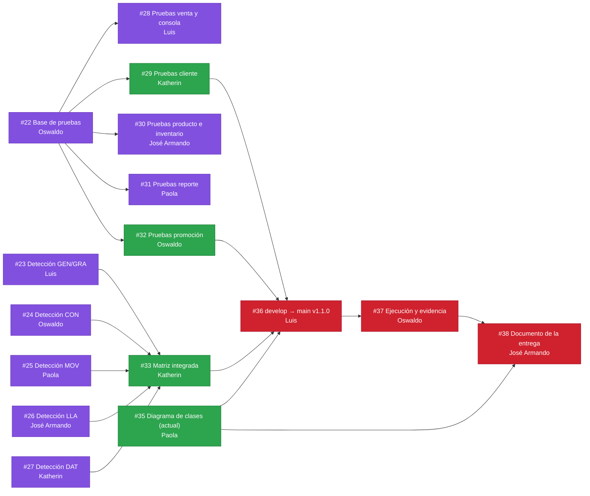

# Planeación — Entrega 2

Issues, responsables, dependencias y calendario hasta la **Entrega 2 (martes 24 de noviembre)**. Las reglas de trabajo están en [`convenciones.md`](convenciones.md).

**Qué pide la Entrega 2:** diagrama de clases y ejecución de las pruebas unitarias. Para esta entrega se presentan la matriz de *code smells*, las pruebas del comportamiento actual de las dos interfaces (10 pruebas, 2 por integrante) y el diagrama de clases del sistema actual.

> [!NOTE]
> **Ajuste al plan (23 de noviembre).** La separación de dominio y presentación (#34) y las refactorizaciones de organización de datos y de llamadas a métodos se movieron a la **Entrega 3**. Primero se aseguraron las pruebas de caracterización de ambas interfaces: sin ellas no se puede comprobar que el sistema conserva su comportamiento después de refactorizar. Por eso el diagrama de esta entrega es del **sistema actual** (línea base), y en la Entrega 3 se actualiza al sistema refactorizado.

> Los números `#22` en adelante son los que tienen los issues en GitHub (del #1 al #21 son del plan anterior y están cerrados).

---

## 1. Issues

### Milestone: Entrega 2 — Pruebas, matriz y diagrama

| # | Issue | Responsable | Depende de | Para cuándo |
|---|---|---|---|---|
| #22 | ISS-22 · Pruebas · Preparar la base de pruebas aislada | Oswaldo | — | Dom 22 · 11:00 |
| #23 | ISS-23 · Generalización y grandes refactorizaciones · Detectar code smells en todo el sistema | Luis | — | Dom 22 · 14:00 |
| #24 | ISS-24 · Condicionales · Detectar code smells en todo el sistema | Oswaldo | — | Dom 22 · 14:00 |
| #25 | ISS-25 · Movimiento de funciones · Detectar code smells en todo el sistema | Paola | — | Dom 22 · 14:00 |
| #26 | ISS-26 · Llamadas a métodos · Detectar code smells en todo el sistema | José Armando | — | Dom 22 · 14:00 |
| #27 | ISS-27 · Organización de datos · Detectar code smells en todo el sistema | Katherin | — | Dom 22 · 14:00 |
| #28 | ISS-28 · Pruebas · Caracterizar venta, método de pago y el menú de consola | Luis | #22 | Dom 22 · 23:59 |
| #29 | ISS-29 · Pruebas · Caracterizar el módulo de clientes | Katherin | #22 | Lun 23 · 23:59 |
| #30 | ISS-30 · Pruebas · Caracterizar producto e inventario | José Armando | #22 | Dom 22 · 23:59 |
| #31 | ISS-31 · Pruebas · Caracterizar el módulo de reportes | Paola | #22 | Dom 22 · 23:59 |
| #32 | ISS-32 · Pruebas · Caracterizar el módulo de promociones | Oswaldo | #22 | Lun 23 · 23:59 |
| #33 | ISS-33 · Matriz · Integrar y revisar la detección de las cinco unidades | Katherin | #23 a #27 | Lun 23 · 23:59 |
| #35 | ISS-35 · Diagrama · Hacer el diagrama de clases del sistema actual | Paola | — | Mar 24 · 07:30 |
| #36 | ISS-36 · Entrega 2 · Integrar develop en main y publicar v1.1.0 | Luis | #29, #32, #33, #35 | Mar 24 · 08:00 |
| #37 | ISS-37 · Pruebas · Ejecutar las pruebas y reunir la evidencia de la entrega | Oswaldo | #36 | Mar 24 · 09:00 |
| #38 | ISS-38 · Entrega 2 · Integrar el documento de la entrega | José Armando | #35, #37 | Mar 24 · 10:00 |

### Movido a la Entrega 3 — Versión final

| # | Qué | Responsable | Depende de |
|---|---|---|---|
| #34 | ISS-34 · Grandes refactorizaciones · Separar la interfaz de la lógica en JavaFXApp y las vistas de consola | Luis coordina; cada quien su módulo (sub-issues) | Las 10 pruebas en `develop` |
| Sub-issues de #34 | Uno por módulo: sacar su pantalla de `JavaFXApp` y su vista de consola | Cada quien el módulo de sus pruebas | Las pruebas de ese módulo |
| Sub-issues de #27 | Refactorizaciones de organización de datos en modelos | Katherin | #33 y las pruebas del módulo |
| Sub-issues de #26 | Refactorizaciones de llamadas a métodos en DAO y controladores | José Armando | #33 y las pruebas del módulo |

Junto con las refactorizaciones de **movimiento de funciones, condicionales y generalización**, que ya estaban planeadas para la Entrega 3.

### Carga por persona (Entrega 2)

| Integrante | Issues |
|---|---|
| Luis | #23 detección, #28 pruebas, #36 integración |
| Oswaldo | #22 base de pruebas, #24 detección, #32 pruebas, #37 ejecución y evidencia · revisa todos los PR de pruebas |
| Paola | #25 detección, #31 pruebas, #35 diagrama de clases |
| José Armando | #26 detección, #30 pruebas, #38 documento |
| Katherin | #27 detección, #29 pruebas, #33 matriz · revisa los PR de la matriz |

---

## 2. Dependencias

🟪 hecho · 🟩 se puede trabajar ya · 🟥 va al final

### Por qué cada dependencia

| Dependencia | Por qué |
|---|---|
| #22 → pruebas por módulo | `ConexionDB` tiene fija la ruta `data/tienda.db`. Sin la base aislada, las pruebas de DAO escriben en la base real. |
| #23 a #27 → #33 | La matriz integra la detección de las cinco unidades. |
| #29, #32, #33 y #35 → #36 | `main` solo recibe `develop` cuando las 10 pruebas, la matriz y el diagrama están fusionados y en verde. |
| #36 → #37 | La evidencia se toma de un clon limpio de `main`, que es lo que se entrega. |
| #35 y #37 → #38 | El documento lleva el diagrama y el reporte de las pruebas. |
| Pruebas → cualquier refactorización (Entrega 3) | Las pruebas son las que demuestran que el sistema hace lo mismo después del cambio. Refactorizar sin ellas no se puede comprobar. |

### Riesgos

- **`JavaFXApp` y `MainView` los tocan todos en #34 (Entrega 3).** Por eso se reparte por módulo y cada quien saca solo su pantalla. Luis integra al final.
- **Las pruebas no cubren las pantallas.** En la Entrega 3, cada sub-issue de #34 incluye probar a mano su pantalla en JavaFX y en consola.

---

## 3. Calendario

| Cuándo | Qué | Quién |
|---|---|---|
| **Dom 22** | #22 base de pruebas, #23 a #27 detección y pruebas de venta, inventario y reportes | ✅ Hecho |
| **Lun 23 · 23:59** | #29 y #32 pruebas fusionadas (completan las 10) y #33 matriz cerrada | Katherin y Oswaldo |
| **Mar 24 · 07:30** | #35 diagrama de clases del sistema actual fusionado | Paola |
| **Mar 24 · 08:00** | #36 `develop` → `main` y etiqueta `v1.1.0` | Luis |
| **Mar 24 · 09:00** | #37 pruebas ejecutadas y evidencia en `Docs/pruebas/entrega-2/` | Oswaldo |
| **Mar 24 · 10:00** | #38 documento de la entrega, con el párrafo del ajuste al plan | José Armando |

**Entrega 3 (jueves 3 de diciembre):** separación de dominio y presentación (#34) y refactorizaciones de organización de datos y llamadas a métodos; después, movimiento de funciones, condicionales y generalización (30 nov), pruebas de caja negra (1 dic, José Armando coordina), matriz de trazabilidad, Javadoc y diagrama de clases del sistema refactorizado (2 dic), versión final `v2.0.0` (3 dic).

---

## 4. Tablero

| Columna | Significa |
|---|---|
| **Bloqueado** | Tiene una dependencia que todavía no está fusionada en `develop`. No se empieza. |
| **Por hacer** | Ya se puede empezar. |
| **En progreso** | Alguien está trabajando en su rama. |
| **En revisión** | Tiene PR abierto y revisor asignado. |
| **Hecho** | El PR se fusionó y el issue está cerrado. |
